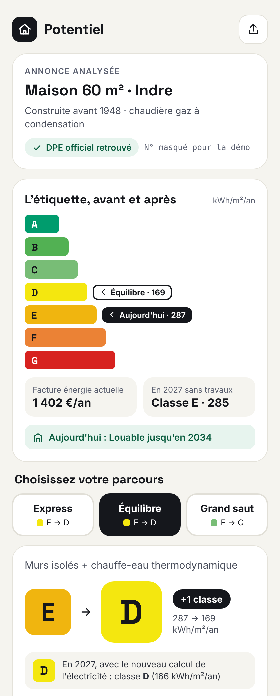

# Potentiel · plans de travaux DPE

**Transformer une annonce immobilière ou un DPE en plan de travaux lisible :**
lettre avant/après, budget ventilé par corps de métier, économies, et trois
parcours au choix.

> *EN — Prototype of a French real-estate tool that turns a property listing or
> its official energy certificate (DPE) into a renovation plan: energy class
> before/after, budget by trade, savings, and three renovation paths. Labels are
> recomputed with the official 3CL method on real certificates from the national
> ADEME database.*

**[▶ Ouvrir la maquette interactive](https://romainyoung.github.io/potentiel-travaux-dpe/demo/)**
· 5 logements réels de l'Indre, anonymisés.

---

## Le problème

Un acheteur qui tombe sur une maison classée F ou G ne sait pas répondre aux
questions qui comptent : combien coûtent les travaux, quels travaux, quelle lettre
on peut viser, et ce que ça change sur la facture et sur le droit de louer
(interdiction progressive des G, puis des F, puis des E). Les montants de travaux
inscrits dans les DPE sont trop grossiers pour décider : ils sont parfois du même
ordre qu'un dîner pour une isolation complète.

## Ce que fait l'outil

Deux portes d'entrée, un seul moteur :

- **Acheteur / investisseur** : il colle le lien d'une annonce. L'outil retrouve le
  DPE officiel, simule les travaux et affiche le résultat. Un geste, zéro saisie.
- **Agent immobilier** : il saisit le numéro DPE de son mandat, ajoute ses photos
  et son descriptif. Version plus simple, données exactes, et un argument de vente
  pour les biens F/G difficiles à vendre.

Pour chaque logement, trois parcours calqués sur la logique du DPE :

| Parcours | Logique |
|---|---|
| **Express** | Le geste qui fait gagner le plus de lettres par euro |
| **Équilibre** | Le meilleur compromis entre facture, lettre et budget |
| **Grand saut** | Viser B, sortir des énergies fossiles |

Chaque parcours donne la nouvelle étiquette (avec le calcul 2027), le budget
TTC hors aides, le devis ligne à ligne par corps de métier, les économies
annuelles, le temps de retour et le statut au regard du calendrier
d'interdiction de location.

## Résultats sur 5 DPE réels de l'Indre

Étiquettes recalculées avec la méthode officielle ; prix d'artisans **simulés**, TTC, hors aides.

| Logement | Actuel | Express | Équilibre | Grand saut |
|---|---|---|---|---|
| Maison 49 m², convecteurs | **G** | D · 4,5 k€ | C · 11,7 k€ | B · 16,6 k€ |
| Appartement 66 m², centre ancien | **G** | F · 1,5 k€ | D · 10,2 k€ | B · 18,7 k€ |
| Maison de maître 378 m², fioul | **F** | E · 3,4 k€ | D · 35,5 k€ | B · 125 k€ |
| Maison 122 m², bois + convecteurs | **F** | D · 11,1 k€ | D · 22,7 k€ | B · 38,3 k€ |
| Maison 60 m², gaz | **E** | D · 6,4 k€ | D · 9,7 k€ | C · 23,5 k€ |

Ce que ces cas montrent :

- **Une lettre peut coûter très peu.** La maison de maître n'est en F qu'à cause de
  son CO₂, à 0,2 kg/m² près : un chauffe-eau thermodynamique à 3 350 € la fait passer en E.
- **Lettres et économies ne vont pas ensemble.** Une pompe à chaleur dans une maison
  déjà chauffée au bois gagne deux lettres pour 239 €/an d'économies. C'est utile pour
  louer, pas pour la facture, et l'outil le dit.
- **2027 change la donne sans travaux.** Le coefficient de l'électricité passe de 2,3 à
  1,9 puis à 1,7 au 1ᵉʳ janvier 2027 : certains logements tout électrique gagnent une
  lettre sans rien faire.
- **Tous les gestes ne se valent pas.** Une VMC ne bouge presque pas l'étiquette ; les
  murs pèsent environ un tiers des déperditions (médiane sur 75 maisons de l'Indre).

Détail de la méthode : [`docs/methode.md`](docs/methode.md).

## Statut

**Prototype de faisabilité.** La chaîne complète, du DPE réel à l'écran de résultat,
a été testée de bout en bout sur des cas réels. La maquette présentée ici est une
vitrine statique : le moteur de calcul n'est pas publié dans ce dépôt.

- [Méthode et chaîne de calcul](docs/methode.md)
- [Risques et défis](docs/risques.md)
- [Feuille de route](docs/feuille-de-route.md)

## Sources et crédits

- **Base des DPE** : ADEME, données publiques sous Licence Ouverte / Open Licence 2.0.
- **Moteur de calcul 3CL** : [Open3CL](https://github.com/Open3CL/engine) (GPL-3.0),
  utilisé pour le recalcul ; non redistribué ici.
- Les cinq logements de la démo sont des DPE réels dont les numéros, adresses et
  communes ont été retirés.

---

© 2026 Romain Lejeune · Tous droits réservés. Les chiffres présentés sont
indicatifs et ne constituent ni un devis ni un audit énergétique.
